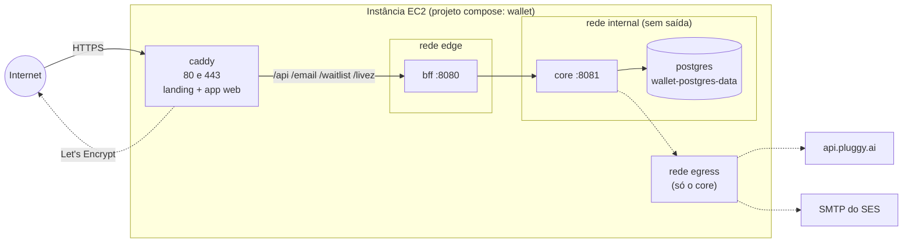

# Deploy

O Wallet inteiro numa instância EC2 só, com HTTPS, para o app abrir de qualquer navegador e a landing e a lista de espera funcionarem de verdade. Tudo vive em `deploy/` e sobe com um `docker compose`. Visão geral das peças: [[Visão Geral]], [[BFF]], [[Core]].

> Estes arquivos só **preparam** o deploy. Nada foi criado na AWS, nenhuma imagem foi publicada em registry e nenhum segredo está no git (só `deploy/.env.example`).

## O desenho



| Rede | Quem está nela | Para quê |
|---|---|---|
| `wallet-internal` (`internal: true`) | postgres, core, bff | Os serviços só falam entre si; o Docker não dá saída para a internet |
| `wallet-edge` | bff, caddy | O Caddy chega ao BFF; o Caddy também precisa de saída, para o Let's Encrypt |
| `wallet-egress` | core | O caminho de saída do core, para a Pluggy e para o SMTP. Nada é publicado nela |

- **Só o Caddy publica portas** (80 e 443). As portas de gestão (9080 do BFF e 9081 do core) escutam em 127.0.0.1 dentro de cada container e não são publicadas.
- `https://<domínio>` serve a landing (`site/`); `https://app.<domínio>` serve o app web e repassa `/api/*`, `/email/*`, `/waitlist/*` e `/livez` ao BFF. App e API na **mesma origem** mantêm o cookie de renovação `SameSite=Strict`. A landing chama a API de outra origem (por isso `WALLET_WEB_ALLOWED_ORIGINS` lista os dois nomes).
- O domínio entra no **build**: o app web é compilado com `WALLET_BFF_URL=https://app.<domínio>` e o `config.js` da landing é gerado com o mesmo endereço. Trocar de domínio exige `docker compose build` de novo.
- Os nomes são todos claros e fixos: projeto `wallet`, containers `wallet-postgres`, `wallet-core`, `wallet-bff`, `wallet-caddy`, volumes `wallet-postgres-data`, `wallet-caddy-data`, `wallet-caddy-config`.

### Arquivos

| Arquivo | O que é |
|---|---|
| `deploy/compose.yaml` | Os quatro serviços, as redes e os volumes |
| `deploy/.env.example` | Todas as variáveis de produção, com comentário. Copie para `deploy/.env` |
| `deploy/caddy/Dockerfile` | Compila o app web (Flutter 3.47.6) e junta com a landing e o Caddyfile |
| `deploy/caddy/Caddyfile` | Os dois nomes, HTTPS automático, proxy para o BFF |
| `core/Dockerfile`, `bff/Dockerfile` | Maven num JDK 25, execução numa JRE 25 (Eclipse Temurin), usuário não-root, perfil `prod` |
| `deploy/backup.sh` | Backup do Postgres |
| `deploy/backup.service.example`, `deploy/backup.timer.example` | O backup diário pelo systemd |
| `.dockerignore` (raiz, `core/`, `bff/`) | Deixa de fora `target/`, `build/`, `.dart_tool/` e qualquer segredo |

### Saúde

- Postgres: `pg_isready`. Core e BFF: `/livez` na porta do próprio serviço. O `depends_on` espera cada um ficar saudável: postgres, depois core, depois bff, depois caddy.
- A JRE da Temurin **não traz `curl` nem `wget`**, e instalar um só para isso engordaria a imagem. O healthcheck usa o `bash` da imagem: abre `/dev/tcp/127.0.0.1/<porta>`, manda `GET /livez` e confere o `200`. Não instala nada.
- O core demora para ficar saudável na primeira subida (as migrations do Flyway rodam nela); o `start_period` já considera isso.
- A saúde com detalhes (`/actuator/health`, na 9081 e na 9080) fica só dentro do container: `docker compose exec core bash -c ...`, ou os logs.

## Do zero: passo a passo

### 1. A instância

- **Ubuntu Server 24.04 LTS**, **2 GB de RAM ou mais**, disco de 20 GB ou mais (SSD), com um **Elastic IP** (o DNS precisa de um IP que não mude).
- **Por que 2 GB:** rodam ao mesmo tempo duas JVMs (core com heap de até 512 MB e BFF com até 256 MB, mais metaspace e threads, em torno de 1,2 GB juntas), o Postgres (uns 250 MB), o Caddy (uns 50 MB) e o sistema. Com 1 GB o Linux começa a matar processos. Os tetos de heap estão em `CORE_JAVA_OPTS` e `BFF_JAVA_OPTS`.
- **O build é mais pesado que a execução**: compilar o app Flutter e o Maven pedem mais memória do que o Wallet usa rodando. Em 2 GB, crie um swap de 2 GB antes do primeiro build (passo 4). Se preferir folga, use uma instância de 4 GB.

### 2. Security group

| Sentido | Porta | Origem | Por quê |
|---|---|---|---|
| Entrada | 80 (TCP) | 0.0.0.0/0 | Desafio do Let's Encrypt e redirecionamento para HTTPS |
| Entrada | 443 (TCP) | 0.0.0.0/0 | O site e o app |
| Entrada | 22 (TCP) | **só o seu IP** | SSH. Nunca aberto para o mundo |

Nenhuma outra porta de entrada: nem 5432 (Postgres), nem 8080, 8081, 9080, 9081. Sobre a saída, veja "O que depende de você".

### 3. DNS

Dois registros **A**, ambos para o Elastic IP:

- `<domínio>` (ex.: `wallet.exemplo.com.br`)
- `app.<domínio>` (ex.: `app.wallet.exemplo.com.br`)

Confira antes de subir: `nslookup app.<domínio>` precisa responder o IP da instância. Sem isso o Caddy não consegue o certificado (e o Let's Encrypt limita tentativas falhas).

### 4. Docker, swap e o código

No servidor, por SSH:

```bash
# Docker Engine + plugin compose, pelo repositório oficial: https://docs.docker.com/engine/install/ubuntu/
sudo usermod -aG docker "$USER"   # sai e entra de novo no SSH depois

# Swap de 2 GB (só para o build não estourar a memória)
sudo fallocate -l 2G /swapfile && sudo chmod 600 /swapfile
sudo mkswap /swapfile && sudo swapon /swapfile
echo '/swapfile none swap sw 0 0' | sudo tee -a /etc/fstab

# O código (o repositório é privado: use uma deploy key somente leitura)
sudo mkdir -p /opt/wallet && sudo chown "$USER" /opt/wallet
git clone git@github.com:rafaeldossanto/Wallet.git /opt/wallet
cd /opt/wallet && git checkout main
```

### 5. O `.env`

```bash
cd /opt/wallet/deploy
cp .env.example .env
chmod 600 .env
```

Preencha cada linha (os comentários do arquivo dizem o que é cada uma). Os segredos:

```bash
openssl rand -base64 33    # POSTGRES_PASSWORD
openssl rand -base64 48    # WALLET_GATEWAY_KEY (mínimo 32 caracteres)
openssl rand -base64 32    # WALLET_DATA_KEY
openssl genpkey -algorithm RSA -pkeyopt rsa_keygen_bits:2048 -out jwt-private.pem
openssl pkey -in jwt-private.pem -pubout -out jwt-public.pem
awk '{printf "%s\\n", $0}' jwt-private.pem    # o valor de WALLET_JWT_PRIVATE_KEY, entre aspas
awk '{printf "%s\\n", $0}' jwt-public.pem     # o valor de WALLET_JWT_PUBLIC_KEY, entre aspas
```

Depois de colar as chaves no `.env`, **apague os `.pem` do servidor** (`shred -u jwt-*.pem`) e guarde uma cópia do par e da `WALLET_DATA_KEY` num gerenciador de senhas. Perder a `WALLET_DATA_KEY` torna ilegíveis as descrições de transação já gravadas; perder o par JWT só derruba as sessões.

O resto: `WALLET_DOMAIN`, `WALLET_ACME_EMAIL`, o SMTP do SES (`WALLET_SMTP_*`, `WALLET_MAIL_FROM`), `PLUGGY_CLIENT_ID` e `PLUGGY_CLIENT_SECRET`. O modo de conexão (`PLUGGY_CONNECT`), a URL pública, as origens do CORS e a conexão com o banco o compose define sozinho.

### 6. Build e subida

```bash
docker compose config -q      # valida o .env e o compose; sem saída = ok
docker compose build          # 10 a 20 minutos na primeira vez (Maven duas vezes e o Flutter)
docker compose up -d
docker compose ps             # os quatro "healthy"/"running"
docker compose logs -f caddy  # acompanha o certificado sair
```

Estando em `deploy/`, o compose acha o `.env` sozinho. Se `up` recusar com `password is not specified` ou `... key`, faltou preencher aquela linha do `.env`. Postgres, core e BFF não sobem sem os segredos de produção: é de propósito.

### 7. Primeiro acesso

1. `curl -I https://app.<domínio>/livez` responde `200`.
2. `https://<domínio>` abre a landing. Entre na lista de espera com um e-mail seu: o e-mail de confirmação chega pelo SES.
3. `https://app.<domínio>` abre o app. Crie a conta, confirme o e-mail e entre.
4. Conectar banco: o widget da Pluggy Connect exige as credenciais de produção da Pluggy em `PLUGGY_CLIENT_ID` e `PLUGGY_CLIENT_SECRET`.

## Atualizar

```bash
cd /opt/wallet/deploy
./backup.sh                          # antes de qualquer atualização
git pull --ff-only
docker compose build
docker compose up -d                 # recria só o que mudou; o core aplica as migrations do Flyway ao subir
docker compose ps
```

- O build do app web e o da landing ficam na imagem do Caddy: qualquer mudança em `app/` ou `site/` pede o `build` e o `up -d`.
- Voltar uma versão: `git checkout <commit anterior>`, `build`, `up -d`. As migrations do Flyway **só andam para frente**: se a versão nova criou colunas, volte também o banco com o backup de antes da atualização (próxima seção).
- Limpeza de imagens antigas, de vez em quando: `docker image prune` (só remove imagens sem uso; os volumes não são tocados).

## Backup e restauração

### Backup

`deploy/backup.sh` faz `pg_dump` pelo `docker compose exec`, comprime e grava `wallet-<data>.sql.gz` em `WALLET_BACKUP_DIR` (padrão `/var/backups/wallet`, modo 700), apaga os de mais de 14 dias e confere se o arquivo descomprime. Com `WALLET_BACKUP_S3_URI` definida e a AWS CLI instalada, também copia para o S3 (a instância precisa de uma role IAM com `s3:PutObject` nesse prefixo).

Todo dia às 03:30, pelo systemd:

```bash
sudo cp /opt/wallet/deploy/backup.service.example /etc/systemd/system/wallet-backup.service
sudo cp /opt/wallet/deploy/backup.timer.example   /etc/systemd/system/wallet-backup.timer
# ajuste User= e os caminhos nos dois arquivos se o repositório não estiver em /opt/wallet
sudo systemctl daemon-reload
sudo systemctl enable --now wallet-backup.timer
systemctl list-timers wallet-backup.timer   # confere a próxima execução
sudo systemctl start wallet-backup.service  # roda uma vez agora, para testar
```

Um backup que ninguém restaurou não é backup: restaure um de vez em quando numa máquina de teste. O dump é só o banco; os segredos (`WALLET_DATA_KEY`, par JWT, senhas) vivem no `.env` e precisam de cópia à parte.

### Restauração

```bash
cd /opt/wallet/deploy
docker compose stop caddy bff core            # ninguém escreve no banco durante a restauração
docker compose exec -T postgres psql -U wallet -d postgres \
  -c "DROP DATABASE wallet WITH (FORCE)" -c "CREATE DATABASE wallet OWNER wallet"
gunzip -c /var/backups/wallet/wallet-<data>.sql.gz \
  | docker compose exec -T postgres psql -U wallet -d wallet -v ON_ERROR_STOP=1
docker compose up -d
```

Para uma máquina nova: faça os passos 1 a 5, restaure o `.env` (a **mesma** `WALLET_DATA_KEY`), suba só o Postgres (`docker compose up -d postgres`), rode o `gunzip | psql` acima (sem o `DROP`) e depois `docker compose up -d`.

## O que depende de você

- **Domínio** e acesso ao DNS dele (os dois registros A).
- **Conta AWS**: a instância, o Elastic IP, o security group e, se quiser, um bucket S3 e a role dele.
- **Amazon SES**: verificar o domínio (ou o remetente), criar o usuário IAM de **SMTP** (a senha SMTP é derivada, não é a secret key) e **pedir saída do sandbox**. No sandbox o SES só envia para endereços verificados: a lista de espera e as confirmações de conta não chegariam às outras pessoas. Use o mesmo remetente em `WALLET_MAIL_FROM`.
- **Restringir a saída para `api.pluggy.ai`**: só o **core** precisa sair para a internet (Pluggy e SMTP do SES), e é por isso que ele tem a rede `egress` só dele; o Postgres fica sem saída nenhuma e o BFF não precisa de saída para a internet. O compose **não filtra por domínio**: essa restrição fica no security group ou no NAT da AWS. Observação: o BFF divide a rede `edge` com o Caddy, que é uma rede comum do Docker e, tecnicamente, deixa o tráfego do BFF sair; por isso a restrição da AWS vale para a máquina toda. O security group, porém, não filtra por nome de servidor (ele trabalha com IPs, e os da Pluggy não são fixos). O que dá para fazer: no security group, limitar a saída às portas 443 (Pluggy, Let's Encrypt, atualizações), 587 (SES), 53 e 123; e, para filtrar por domínio de verdade, passar a saída por um proxy ou pelo AWS Network Firewall com uma lista que contenha `api.pluggy.ai` e o servidor SMTP do SES. Fica como decisão sua; sem isso a saída é restrita por porta, não por destino.
- **Credenciais de produção da Pluggy** (o plano Meu Pluggy é só para uso pessoal; ver [[Custos]]).
- **Android voltar a só HTTPS**: em `app/android/app/src/main/res/xml/network_security_config.xml` o tráfego em texto puro está liberado para o desenvolvimento. Com o BFF em HTTPS, troque `cleartextTrafficPermitted` para `false` e gere o app com o endereço novo:

  ```bash
  flutter build apk --release --dart-define=WALLET_BFF_URL=https://app.<domínio>
  ```

  O mesmo `--dart-define` vale para o app do Windows. Isso é mudança de código do app e ficou de fora deste deploy.
- **Textos legais** da landing (`privacidade.html` e `termos.html` ainda dizem "Em preparação"): precisam existir antes de abrir para outras pessoas. Ver [[Landing Page]].

## Quando algo não sobe

| Sintoma | Onde olhar |
|---|---|
| `up` recusa com variável faltando | A linha do `.env` que a mensagem cita |
| `wallet-postgres` não fica saudável | `docker compose logs postgres`: `POSTGRES_PASSWORD` vazia, ou volume de uma versão antiga do Postgres |
| `wallet-core` reinicia | `docker compose logs core`: em produção ele recusa subir sem chave do gateway forte, chaves JWT, `WALLET_DATA_KEY`, SMTP e `WALLET_PUBLIC_URL` |
| Navegador avisa de certificado | `docker compose logs caddy`: quase sempre o DNS ainda não aponta para a instância, ou as portas 80/443 não estão abertas |
| O formulário da landing mostra "Não foi possível enviar" | O console do navegador: CORS (origem fora de `WALLET_WEB_ALLOWED_ORIGINS`) ou o BFF fora do ar |
| A instância "morre" no build | Memória: confira o swap (passo 4) |
