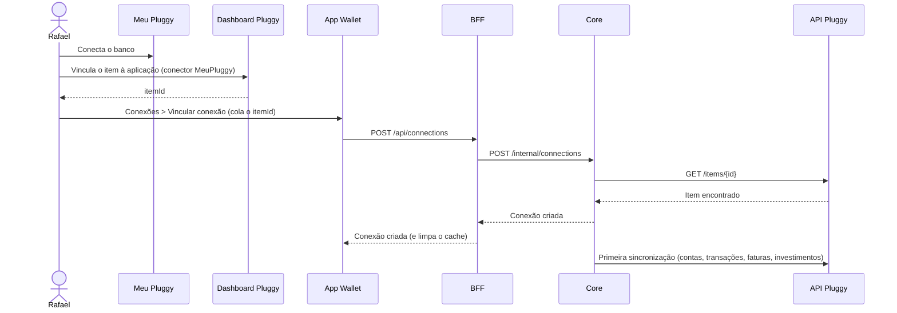
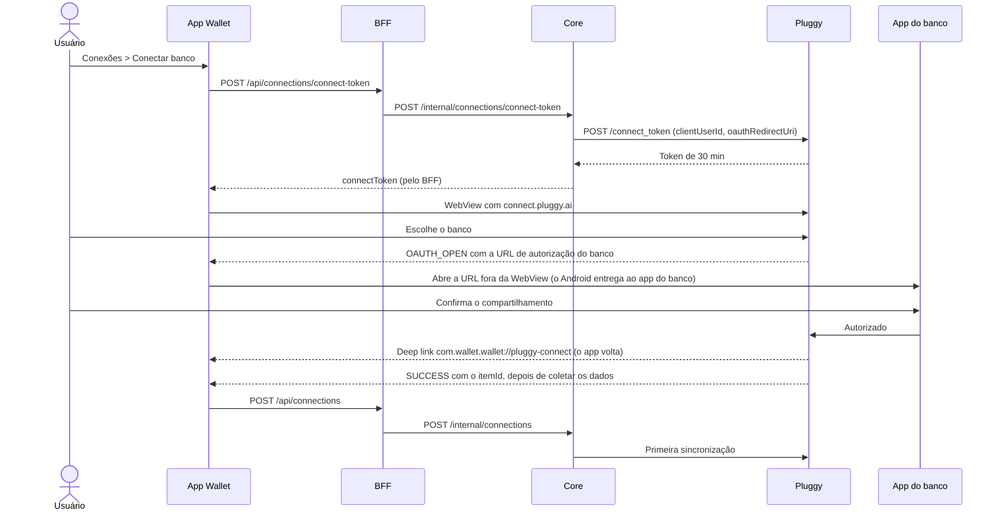

# Fluxo de Conexão

Como uma conta de banco passa a aparecer no Wallet. São dois caminhos, e os dois terminam no
mesmo `POST /api/connections` com o `itemId`; só muda de onde o ID vem.

| Caminho | Onde | De onde vem o item |
|---|---|---|
| **Item ID** | Conexões → "Vincular conexão" (iOS, PC, navegador); no Android, o ícone de link no topo | Meu Pluggy ou a Pluggy de demonstração |
| **Pluggy Connect** | Conexões → "Conectar banco", no **Android** (desde 2026-10-18) | O widget da Pluggy, criado para o usuário |

`wallet.provider.connection-mode` no core decide quem pode vincular o quê (ver "Dono do item").

## Item ID: Meu Pluggy

Detalhes e limites em [[Meu Pluggy no Desenvolvimento]].

## Pluggy Connect no Android

Pedido do Rafael em 2026-10-18: tocar em conectar e cair direto no app do banco, onde ele já está
logado.

- **Token:** só o core cria (precisa do Client Secret). Vai com `clientUserId` = id do usuário no
  Wallet e `oauthRedirectUri` = `wallet.provider.oauth-redirect-uri`. A Pluggy aceita HTTPS ou
  deep link, nunca localhost, e recusa na criação do token. Vale 30 min, para uma conexão; cada
  toque em "Conectar banco" pede um novo. A chamada sai no registro de auditoria com o motivo
  `CONNECT` ([[Core]]).
- **WebView:** o app fala com o widget pelo mesmo protocolo dos SDKs móveis da Pluggy
  (`react-native-pluggy-connect` 1.6 e `flutter_pluggy_connect` 3.0): um canal
  `window.ReactNativeWebView.postMessage` por onde o Connect manda `OAUTH_OPEN` (a URL do banco),
  `LINK_OPEN` (termos, privacidade) e `LOCATION` (a query da página, com cada evento em `events`,
  `item_id`, `item_status`). Código em `app/lib/features/connections/data/pluggy_connect.dart`.
- **Por que não o pacote `flutter_pluggy_connect`:** a 3.0.1 (de 2024) fecha a própria tela ao
  carregar se algum deep link já chegou ao app, então a segunda conexão depois de uma volta do
  banco fecharia sozinha; e ela usa o Material antigo do framework, não o `material_ui`.
- **Abrir o banco:** a URL de autorização vai para o `url_launcher`, primeiro só para apps que não
  são navegador (o app do banco, pelos app links que os bancos do Open Finance publicam), e, se
  nenhum app a reivindicar, para o navegador. Se nada abrir, o Connect é avisado e mostra o erro.
- **A volta:** o banco devolve para a Pluggy, que redireciona para
  `com.wallet.wallet://pluggy-connect`. O `AndroidManifest.xml` tem o intent filter desse
  endereço; a activity é `singleTask`, então a volta cai na mesma tela do Connect (e limpa o que o
  banco deixou por cima), e o deep linking do próprio Flutter está desligado, para o go_router
  não tratar o link como rota. O Connect continua sozinho: ele consulta o item até a coleta
  terminar.
- **Quando vincular:** no `SUCCESS` (dados coletados). Se a pessoa sair antes (voltar ou fechar)
  com o banco já autorizado e os dados chegando, o item também é vinculado; a primeira
  sincronização pode ainda achar a Pluggy atualizando, e os dados vêm com o "Atualizar" (15 min
  depois dessa tentativa, ver [[Sincronização]]) ou na sincronização agendada. Saindo antes de autorizar, nada é vinculado.
- **Depois:** a tela de Conexões acompanha a primeira sincronização como no vínculo pelo Item ID
  (consulta a cada 3 s).
- **Pluggy de demonstração:** responde ao `/connect_token` (com a mesma regra do redirect), mas o
  widget de verdade não aceita o token dela. Com a demo, use o Item ID.
- **Sandbox:** em build de debug o widget mostra também os bancos de teste da Pluggy.

## Consentimento (desde 2026-10-23)

LGPD L3 (a finalidade antes dos dados) e L5 (o fim da autorização).

**Antes de conectar.** Toda conexão nova e toda renovação começa na tela **"Antes de conectar"** do app,
seja por Pluggy Connect ou por Item ID: a finalidade ("Mostrar seus saldos, extratos, cartões, faturas e
investimentos no Wallet."), os dados lidos (contas e saldos, lançamentos, cartões e faturas, investimentos),
"O Wallet só lê: não movimenta dinheiro.", a validade ("Até você desconectar aqui ou no app do banco, ou até
a autorização vencer.") e como revogar. A caixa "Autorizo o Wallet a ler esses dados para essa finalidade."
nasce **desmarcada** e só a pessoa a marca; sem ela o botão "Continuar" não anda. O texto tem uma versão,
`open-finance-v1` (`ConnectionsApi.consentVersion`), e mudar o texto é uma versão nova.

**O contrato.** O app manda `consentVersion` em `POST /api/connections` e em
`POST /api/connections/connect-token`, e o core **exige**: sem ele, `400 validation.failed` e a Pluggy nem é
chamada. O core grava uma linha em `connection_consents` a cada vínculo e a cada renovação (versão, escopos
`ACCOUNTS,TRANSACTIONS,CREDIT_CARDS,INVESTMENTS`, `granted_at`, `expires_at` informado pela Pluggy). Desvincular
grava `revoked_at` e só então apaga a conexão. A tabela **não tem chave estrangeira** para `connections` de propósito:
um `ON DELETE CASCADE` apagaria a prova da concessão e da revogação junto com a conexão, justamente quando a pessoa
a revoga. O registro pertence ao usuário (`user_id` em cascata): some só com a exclusão da conta.
Ver [[Modelo de Dados]].

**Quando a autorização vence (L5).** A conexão com `consent_expires_at` no passado:

- a **sincronização agendada** não chama a Pluggy: marca a conexão `CONSENT_EXPIRED` (status novo) e a rodada
  termina `SKIPPED connection.consent_expired`; dali em diante a agendada nem olha para ela;
- o **"Atualizar"** responde `409 connection.consent_expired` e também marca a conexão;
- os dados dela **não são apagados** (a retenção é outra tarefa);
- o app mostra "A autorização deste banco venceu. Renove para voltar a atualizar." com o botão **Renovar**; faltando
  7 dias ou menos, "A autorização vence em N dias." (também com o botão); fora do Android, "Renove pelo app no celular.".

**Renovar (Android).** O app mostra a tela de finalidade e abre o Pluggy Connect **em modo atualização**:
`POST /api/connections/connect-token` com `{consentVersion, connectionId}` (só conexão do próprio usuário;
a de outro é `404 connection.not_found`) e o core pede o token à Pluggy com o `itemId` da conexão
(`POST /connect_token` com `itemId` no topo do corpo, ao lado de `options`; o widget recebe o token e
`updateItem`). Quando o widget termina, o app chama `POST /api/connections/{id}/renew` `{consentVersion}`: o core
lê o item na Pluggy (fora de transação, `provider_calls.reason = RENEW`) e, se a data de validade avançou e está no
futuro, grava a validade nova, volta a conexão para `ACTIVE`, escreve uma linha nova em `connection_consents` e
publica `ConnectionRenewed`. Se a Pluggy ainda mostra a data velha (o widget foi fechado antes), `409
connection.consent_not_renewed` e nada muda. O `/renew` conta no **mesmo limite por usuário do vincular** no BFF
(10 por hora, `429 rate_limit.connections`).

**A atualização depois da renovação** é a do botão: o `ConnectionRenewed` chama o `ManualSyncService`, com o
**cooldown** (15 min) e o **bulkhead** `manual-sync` dele. O que eles recusam não é erro: a conexão já está ACTIVE e a
agendada lê na próxima volta. A rodada `SKIPPED` do vencimento não conta para o cooldown (não leu nada).

## Dono do item

| Item | `MEU_PLUGGY` (dev) | `PLUGGY_CONNECT` (produção) |
|---|---|---|
| Do Meu Pluggy (sem `clientUserId`) | Vincula | Recusa (parece inexistente) |
| Do widget, deste usuário | Vincula | Vincula |
| Do widget, de outro usuário | Recusa (parece inexistente) | Recusa (parece inexistente) |
| Já vinculado por outro usuário | Recusa (parece inexistente) | Recusa (parece inexistente) |
| Já vinculado por este usuário | 409 `connection.already_linked` | 409 `connection.already_linked` |

"Parece inexistente" é a mesma resposta de um item que a Pluggy não conhece (404
`connection.item_not_found`), depois da mesma consulta à Pluggy. Até 2026-10-21 o "já vinculado"
era conferido antes do dono e respondia 409 para qualquer pessoa, o que dizia que alguém usava o
Wallet com aquele item (achado A17). Agora só o dono ouve o 409.

O `MEU_PLUGGY` aceita item sem dono de **qualquer** usuário: é como o Item ID do Meu Pluggy é
vinculado no desenvolvimento. Num servidor, quem descobrisse um itemId do operador leria os dados
dele (achado A6). Por isso, com `SPRING_PROFILES_ACTIVE=prod` o core **não sobe** se
`WALLET_CONNECTION_MODE` não for `PLUGGY_CONNECT`, e a mensagem diz a variável. Fora do `prod` o
padrão continua `MEU_PLUGGY`.

## Limites

Cada vínculo faz o core ler até um ano do banco na Pluggy, e cada token do widget é uma chamada à
Pluggy, tudo na apiKey de todos os usuários (achados A7, A8 e A9).

| Limite | Onde | Padrão | Resposta |
|---|---|---|---|
| Conexões por usuário | Core (`wallet.provider.max-connections-per-user`) | 10 | 422 `connection.limit_reached` |
| Vínculos (`POST /api/connections`), contando tentativas que falham | BFF (`wallet.rate-limit.link-limit` / `link-window`) | 10 por hora, por usuário | 429 `rate_limit.connections` |
| Renovar (`POST /api/connections/{id}/renew`) | BFF, o mesmo contador do vincular (`wallet.rate-limit.link-limit` / `link-window`) | 10 por hora, por usuário | 429 `rate_limit.connections` |
| Tokens do widget (`POST /api/connections/connect-token`) | BFF (`wallet.rate-limit.connect-token-limit` / `connect-token-window`) | 10 por hora, por usuário | 429 `rate_limit.connections` |

- O teto vale também com pedidos em paralelo. As conferências (já vinculado por este usuário,
  teto) rodam duas vezes: antes da consulta à Pluggy, para que um item repetido ou um usuário no
  teto não gaste chamada; e de novo numa transação curta que só conta e grava, com um advisory
  lock do Postgres por usuário (`UserLinkLock`), onde os vínculos de um usuário passam um de cada
  vez.
- A consulta à Pluggy fica **fora** de qualquer transação, ao vincular e ao desvincular, como na
  sincronização (ver [[Sincronização]]): quem espera a Pluggy não segura conexão do banco. Até a
  revisão do PR #4 (2026-10-22) ela ficava dentro, e dez vínculos (ou desvínculos) em paralelo de
  um usuário com a Pluggy lenta ocupavam o pool inteiro: os outros usuários recebiam 503
  `service.busy` (`ConnectionSlowProviderIT`).
- Os limites do BFF somam ao geral (300 por minuto) e ficam na memória: reiniciar o BFF zera as
  contas. A janela é fixa a partir do primeiro pedido; o `Retry-After` diz a janela inteira.

Desvincular revoga o item na Pluggy (e o consentimento do Open Finance com ele) em produção e,
no modo dev, quando o item foi criado pelo widget para aquele usuário. Item do Meu Pluggy só sai do
Wallet. Se a Pluggy não responder ao conferir o dono, o Wallet desvincula sem revogar. Se a
revogação falhar, a conexão fica: a linha só é apagada depois que a Pluggy revogou, numa
transação curta.

## Pontos de atenção

- A **chave de API** da Pluggy fica só no core. O app recebe só o connect token.
- A Pluggy **não assina** os webhooks. Proteção: header secreto no cadastro do
  webhook e lista de IPs. O BFF é a porta pública e só encaminha para o core. Ver
  [[Sincronização]]. O token ainda não leva `webhookUrl`: falta o deploy.
- Reconectar um banco cria um item novo, com IDs novos de transação.
- iOS fica com o Item ID enquanto o iPhone está pausado; para o Connect lá falta o URL type do
  deep link no `Info.plist`.

Regras que o fluxo cumpre: [[Consentimento]]. Onde cada peça roda: [[Visão Geral]].
