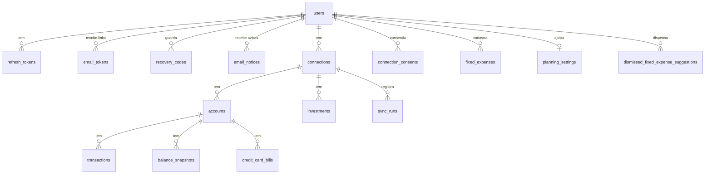

# Modelo de Dados

PostgreSQL 18, migrations com **Flyway**, nomes em inglês. Dinheiro em
`NUMERIC(19,2)`, datas de negócio em `DATE`, carimbos em `TIMESTAMPTZ`.

## Tabelas

**users** — `id uuid`, `email` (único, minúsculo), `password_hash`, `display_name`,
`email_confirmed_at` (vazio = conta esperando o link do cadastro; ninguém entra antes),
`totp_secret` (segredo do segundo fator em base32, **cifrado** com a `WALLET_DATA_KEY`),
`totp_enabled_at` (vazio com segredo = configuração esperando o primeiro código), `totp_last_step`
(último passo de 30 s aceito: cada código vale uma vez), `created_at`. Desde a V10 o bloqueio
saiu daqui (`failed_login_count` e `locked_until` foram removidos) e foi para `login_throttles`.
Conta não confirmada é apagada depois de 7 dias. `password_changed_at` (V13) é quando a senha mudou pela última
vez (redefinição ou troca; vazio = nunca): os access tokens emitidos antes são recusados. `terms_version` e `terms_accepted_at` (V16) são a
versão dos Termos de Uso e da Política de Privacidade que a pessoa aceitou e quando (L15); vazios nas contas de antes, que aceitam no
próximo acesso ([[Autenticação#Aceite dos Termos de Uso e da Política de Privacidade (L15, desde 2026-10-24)]]).

**email_tokens** (V10) — os links mandados por e-mail: `id`, `user_id` (FK `users`, cascata),
`purpose` (`CONFIRM_ACCOUNT`, `CHANGE_EMAIL` ou, desde a V12, `PASSWORD_RESET`: o link de "Esqueci minha
senha", que vale 1 h; a V12 só refez o `CHECK` da coluna), `token_hash` (SHA-256, único; nunca o token),
`new_email` (só na troca de e-mail), `expires_at` (24 h), `used_at` (aberto, ou trocado por um link
mais novo da mesma finalidade), `created_at`. Os vencidos há mais de um dia são apagados à noite.

**recovery_codes** (V10) — códigos de recuperação do segundo fator: `id`, `user_id` (FK, cascata),
`code_hash` (SHA-256 de um código de 80 bits), `used_at`, `created_at`. Dez por vez; ligar de novo
troca todos, desligar apaga.

**login_throttles** (V10) — as falhas de login, sem FK e sem e-mail ou IP em claro:
`subject_hash` (chave: SHA-256 de `account:<e-mail>` ou `source:<e-mail>|<endereço>`), `failures`,
`lockouts` (quantas travas seguidas; cada uma dura o dobro), `locked_until`, `last_failure_at`.
Tem linha também para e-mail sem conta, para o bloqueio responder igual. Linhas sem falha há um
dia somem na limpeza noturna. Ver [[Autenticação#Bloqueio progressivo (achado A5, desde 2026-10-22)]].

**email_notices** (V10) — quando cada aviso foi a cada conta (`user_id` + `kind`, chave composta;
`sent_at`), para limitar a 1 por hora o aviso de tentativa de cadastro e o de conta travada.

**waitlist_entries** (V11) — a lista de espera da landing page, **sem FK** com `users` (quem se
inscreve ainda não tem conta), por isso fora do diagrama: `id`, `email` (`VARCHAR(320)`, único,
sem espaços e em minúsculo, **em claro** como `users.email`: o comunicado vai para ele), `status`
(`PENDING` ou `CONFIRMED`), `consent_version` (a versão do texto aceito, `waitlist-v1`, gravada pelo
servidor), `created_at`, `confirmed_at`, `confirm_token_hash` (SHA-256, único; continua depois de
confirmar, para abrir o link duas vezes não dar erro) com `confirm_token_expires_at` (24 h) e
`confirm_sent_at` (no máximo um e-mail por hora), `unsubscribe_token` (único, nasce na
confirmação, **em claro** de propósito: cada comunicado refaz o link de cada pessoa, e o token só
apaga a própria linha), `last_announcement` e `last_announced_at` (o último comunicado que a pessoa
recebeu, para rodar o comando de novo não reenviar). Descadastrar **apaga a linha**. `PENDING` com
mais de 7 dias é apagado à noite (índice parcial em `created_at`). Ver [[Core#Lista de espera (módulo `waitlist`, desde 2026-10-23)]].

**refresh_tokens** — `id`, `user_id`, `token_hash` (SHA-256, nunca o token puro),
`family_id`, `expires_at`, `rotated_at`, `revoked_at`, `created_at`. Ver
[[Autenticação]].

**connections** — `id`, `user_id` (FK `users`, cascata), `provider` (`PLUGGY`),
`provider_item_id` (único por provedor), `institution_name`, `institution_image_url`,
`status` (`ACTIVE`, `SYNCING`, `NEEDS_ATTENTION` e, desde a V13, `CONSENT_EXPIRED`; `VARCHAR(20)` sem
`CHECK`, então a V13 não mexeu na coluna), `provider_updated_at`,
`last_synced_at`, `consent_expires_at`, `created_at`, `updated_at`. Desvincular
apaga a linha, e a cascata leva tudo o que foi sincronizado.

**connection_consents** (V13) — o que a pessoa aceitou ao conectar um banco (LGPD L3), uma linha a cada vínculo e
a cada renovação: `id`, `user_id` (FK `users`, cascata), `connection_id` (**sem FK**, de propósito),
`purpose_version` (o texto da tela "Antes de conectar" que ela aceitou, hoje `open-finance-v1`, enviado pelo app e
exigido pelo core), `data_scopes` (o que o Wallet lê: `ACCOUNTS,TRANSACTIONS,CREDIT_CARDS,INVESTMENTS`),
`granted_at`, `expires_at` (a validade que a Pluggy informou) e `revoked_at` (quando ela desvinculou). Desvincular
grava `revoked_at` e depois apaga a conexão; como a tabela não tem chave estrangeira para ela, **a prova da
concessão e da revogação sobrevive ao desvínculo** (um cascade a levaria junto) e só some com a exclusão da conta
(`user_id` em cascata). Ver [[Fluxo de Conexão#Consentimento (desde 2026-10-23)]].

**accounts** — `id`, `connection_id` (FK, cascata), `user_id`,
`provider_account_id` (único por conexão), `kind` (`CHECKING`, `SAVINGS`,
`CREDIT_CARD`, `OTHER`), `name`, `number_last_digits`, `currency_code`, `balance`,
`credit_limit`, `available_credit`, `created_at`, `updated_at`.

> [!note] `user_id` repetido
> Contas, transações e investimentos guardam `user_id`, mesmo alcançável pela conexão.
> Toda leitura filtra pelo dono num índice, sem fazer join com a tabela de outro módulo.

**balance_snapshots** — `account_id`, `snapshot_date`, `balance`. Chave
(`account_id`, `snapshot_date`). Um por dia, gravado na sincronização. É o que permite
o gráfico de patrimônio, porque o Open Finance não devolve saldo de dias passados.

**transactions** — `id`, `account_id`, `provider_transaction_id`,
`provider_reconcile_id`, `booked_on`, `description` (**criptografada**), `amount`
(sempre positivo), `direction` (`INFLOW`/`OUTFLOW`), `status`
(`PENDING`/`POSTED`), `category`, `installment_number`, `installment_total`,
`provider_bill_id`, `deleted_at`, `created_at`, `updated_at`. Único
(`account_id`, `provider_transaction_id`). Índices (`account_id`, `booked_on`) e
(`user_id`, `booked_on`) só das não removidas. `description` é `VARCHAR(2000)`, porque
o texto cifrado em base64 ocupa mais que o original.

**credit_card_bills** — `id`, `account_id`, `provider_bill_id` (único), `due_date`,
`total_amount`, `minimum_payment`, `currency_code`.

**investments** — `id`, `connection_id`, `provider_investment_id` (único), `kind`
(`FIXED_INCOME`, `TREASURY`, `FUND`, `EQUITY`, `OTHER`), `name`, `balance`,
`amount_invested`, `due_date`, `closed_at`, `updated_at`. Índices: único em (`connection_id`, `provider_investment_id`), o parcial das
posições abertas (`user_id` onde `closed_at` é nulo) e, desde a V14, `ix_investments_user_id`, que cobre também as fechadas (a
exportação e o histórico leem todas).

**investment_snapshots** — `investment_id`, `snapshot_date`, `balance`. Chave
(`investment_id`, `snapshot_date`). Mesmo papel dos `balance_snapshots`, para o gráfico
de patrimônio. Uma posição fechada ganha um snapshot zerado no dia em que fechou, senão
seria carregada para a frente para sempre.

**sync_runs** — `id`, `connection_id`, `trigger` (`INITIAL`, `SCHEDULED`, `MANUAL`,
`WEBHOOK`), `status` (`RUNNING`, `SUCCEEDED`, `SKIPPED`, `FAILED`), `error_code`,
`started_at`, `finished_at`, `accounts_count`, `transactions_upserted`,
`transactions_deleted`. Índice único parcial: uma `RUNNING` por conexão. Ver
[[Sincronização]].

**provider_calls** — a auditoria das chamadas à Pluggy, uma linha por requisição HTTP:
`id`, `called_at`, `provider` (`PLUGGY`), `operation` (`FIND_ITEM`, `LIST_TRANSACTIONS`...),
`reason` (`CONNECT`, `LINK`, `RENEW`, `UNLINK`, `ACCOUNT_DELETION`, `INITIAL_SYNC`, `SCHEDULED_SYNC`,
`MANUAL_SYNC`, `WEBHOOK_SYNC`, `WEBHOOK_SETUP`), `user_id`, `connection_id`, `provider_item_id`, `outcome`
(`SUCCESS`/`FAILURE`), `http_status`, `error_code`, `duration_ms`. Índices em `called_at` e
em (`connection_id`, `called_at`). **Sem chave estrangeira**, por isso fica fora do diagrama:
o registro precisa sobreviver ao desvínculo e à exclusão do usuário. Nenhum dado financeiro,
token ou credencial. Apagado depois de 180 dias. Ver [[Core#Auditoria das chamadas à Pluggy (desde 2026-10-18)]].

**provider_webhook_events** (V16) — os avisos (webhooks) que a Pluggy mandou, uma linha por evento: `id`, `event_id`
(`VARCHAR(100)`, **único**: um aviso repetido é ignorado com `INSERT ... ON CONFLICT DO NOTHING`), `event` (`item/updated`,
`transactions/created`...), `provider_item_id`, `received_at`, `processed_at` e `outcome` (`SYNC_REQUESTED`, `SKIPPED_COOLDOWN`,
`SKIPPED_BUSY`, `UNKNOWN_ITEM`, `ITEM_DELETED`, `CONSENT_EXPIRED` ou `FAILED`). **Sem chave estrangeira e sem usuário**, por isso fora do
diagrama: o aviso é só uma dica não assinada, o Wallet guarda dele apenas esses três campos, e um item que ninguém vinculou também
é registrado. Apagado depois de 30 dias. Ver [[Sincronização#Webhooks (desde 2026-10-24, achado A21)]].

**fixed_expenses** — os gastos fixos do planejamento (o que não passa no cartão): `id`,
`user_id` (FK `users`, cascata), `name` (**cifrado**, `VARCHAR(512)` desde a V14; ver [[#Criptografia de coluna]]), `amount` (maior que zero), `day_of_month` (1 a 31; nos
meses mais curtos cai no último dia), `category` (uma categoria da Pluggy, opcional),
`created_at`, `updated_at`. Repetem em todo mês. Ver [[Core#Planejamento do mês (desde 2026-10-18)]].

**planning_settings** — uma linha por usuário que ajustou o planejamento: `user_id` (chave e FK
`users`, cascata), `expected_salary` (maior que zero; vazio = prever pelo mês anterior),
`created_at`, `updated_at`.

**dismissed_fixed_expense_suggestions** (V9) — as sugestões de gasto fixo que a pessoa dispensou,
para não voltarem: `id`, `user_id` (FK `users`, cascata), `description_key` (impressão digital
HMAC das palavras da descrição dos débitos, nunca a descrição), `day_of_month` (1 a 31; a dispensa
cobre 3 dias para cada lado), `created_at`. Único por (`user_id`, `description_key`,
`day_of_month`). As sugestões em si não são gravadas: saem das transações a cada leitura. Ver
[[Core#Gastos fixos sugeridos pelo extrato (desde 2026-10-18)]].

**access_records** (V14) — os registros de acesso do Marco Civil da Internet (art. 15): `id`, `user_id`
(**sem FK**, de propósito), `event` (`LOGIN` ou `REFRESH`), `ip` (**cifrado**), `occurred_at`. Uma linha a cada login com sucesso e a cada
refresh. Sem FK porque o registro tem de sobreviver à exclusão da conta pelos 6 meses (obrigação legal, LGPD art. 16, I). Nenhuma rota lê esta
tabela: o acesso só acontece por ordem judicial, direto no banco. Apagada toda noite a partir de 185 dias ([[Core#Registros de acesso (L13)]]).

> [!warning] Validação do Hibernate
> `ddl-auto: validate` recusa `CHAR(n)` e `TEXT` onde a entidade tem `String`, porque
> espera `VARCHAR`. Por isso o schema usa `VARCHAR` em tudo, até em `currency_code`.

## Criptografia de coluna

- `transactions.description` passa por um `AttributeConverter` com **AES-256-GCM**;
  a chave vem de `WALLET_DATA_KEY`. O valor gravado leva um prefixo de versão da chave
  (`v1:`) para permitir rotação.
- `fixed_expenses.name` (L7, desde 2026-10-24) também é cifrado, por um conversor próprio
  (`LegacyAwareEncryptedStringConverter`) que aceita o valor **legado**: sem o prefixo `v1:` volta como está. O
  `FixedExpenseNameBackfill` cifra em lotes, na subida, as linhas que ainda estão em claro (idempotente: o que já tem
  prefixo não é tocado, e rodar de novo não muda nada). Como o texto cifrado não ordena, o desempate por nome dentro do
  mesmo dia é feito em memória, depois de decifrar.
- `access_records.ip` (L13) é cifrado do mesmo jeito que a descrição.
- Sem chave configurada, o core usa uma temporária e avisa no log; com o perfil `prod`, não
  sobe. Um valor que não
  decifra (gravado com outra chave) volta como `null` em vez de derrubar a leitura.
- Valor, data, direção e categoria ficam abertos: são o que as somas e os gráficos
  usam.
- Consequência: a busca por texto no extrato não roda em SQL. O core filtra em
  memória dentro do período pedido (um mês de uma pessoa tem centenas de linhas).

## Exclusão

- Transação que some da Pluggy recebe `deleted_at` (soft delete): a Pluggy pode apagar
  e recriar a mesma transação com outro ID. Ver [[Sincronização]].
- **Excluir a conta (LGPD, art. 18, VI), desde 2026-10-19:** `DELETE /api/me` no BFF, que chama
  `DELETE /internal/me` no core (`AccountDeletionService`). Até essa data o schema já
  cascateava, mas não existia rota nenhuma para excluir a conta. A ordem importa:
  0. **A senha de novo** (`{"password": "..."}` no corpo): o access token sozinho, roubado ou
     num celular desbloqueado, não apaga uma conta. Senha errada responde **403**
     `auth.wrong_password` (403 e não 401, para o app não tratar como sessão vencida) e conta para
     o bloqueio como um login errado; conta bloqueada responde 423 `auth.locked`. Nada é revogado
     nem apagado antes disso.
  1. Primeiro, fora de transação, cada conexão é revogada na Pluggy (`deleteItem`), enquanto o
     Wallet ainda sabe quais itens são do usuário. Mesma regra do desvínculo: em produção
     (`PLUGGY_CONNECT`) revoga sempre; no dev, só os itens que o widget criou para o usuário (item
     do Meu Pluggy é da conta do Meu Pluggy, o Wallet só solta). **Falha da Pluggy não impede a
     exclusão**: fica no log `[SECURITY]` (com `userId` e `connectionId`, sem e-mail nem valores)
     e em `provider_calls` com `reason = ACCOUNT_DELETION`, para revogar à mão depois.
  2. Depois, numa transação, a linha do usuário é travada com `FOR UPDATE` de verdade
     (`findByIdLockingReferences`; o `PESSIMISTIC_WRITE` do Hibernate vira `FOR NO KEY UPDATE`
     no Postgres e não seguraria um vínculo concorrente), as conexões vinculadas no meio do
     caminho também são revogadas, e o `users` é apagado.
  3. O cascade do schema leva `connections`, `accounts`, `transactions`, `balance_snapshots`,
     `credit_card_bills`, `investments`, `investment_snapshots`, `sync_runs`, `fixed_expenses`,
     `planning_settings`, `dismissed_fixed_expense_suggestions`, `refresh_tokens`, `email_tokens`,
     `recovery_codes` e `email_notices`. (`login_throttles` não tem FK: as linhas somem sozinhas em
     um dia. `access_records` também não tem, de propósito: os registros de acesso ficam 6 meses depois da
     exclusão, como a lei manda.)
  4. No BFF, o cookie `wallet_refresh` é apagado e o cache de telas do usuário, descartado. O BFF
     espera o core por até 2 min nessa rota (`wallet.core.slow-read-timeout`), e não os 5 s de
     sempre: cada revogação na Pluggy pode levar até 10 s.
- Só o próprio usuário exclui a própria conta (o id vem do JWT). Desde 2026-10-22 o access token
  ainda válido (até 15 min) recebe **401 `auth.unauthenticated` em qualquer rota**, inclusive numa
  segunda exclusão: o core confere a cada requisição que o usuário do token existe (antes, uma
  escrita nessa janela batia na FK e virava 500). O serviço continua tolerando duas exclusões
  simultâneas (a segunda não acha o usuário e termina sem erro).
- **`provider_calls` fica**, de propósito: sem chave estrangeira, sem dado financeiro, e os 180
  dias de retenção também guardam o registro de que os itens foram revogados. O `user_id` que
  sobra não aponta para ninguém (pseudônimo) e some quando a retenção vence.

Ver também [[Core]].
